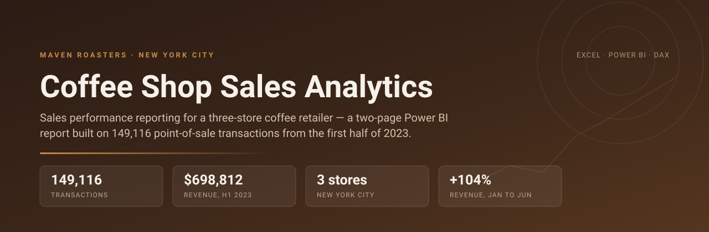
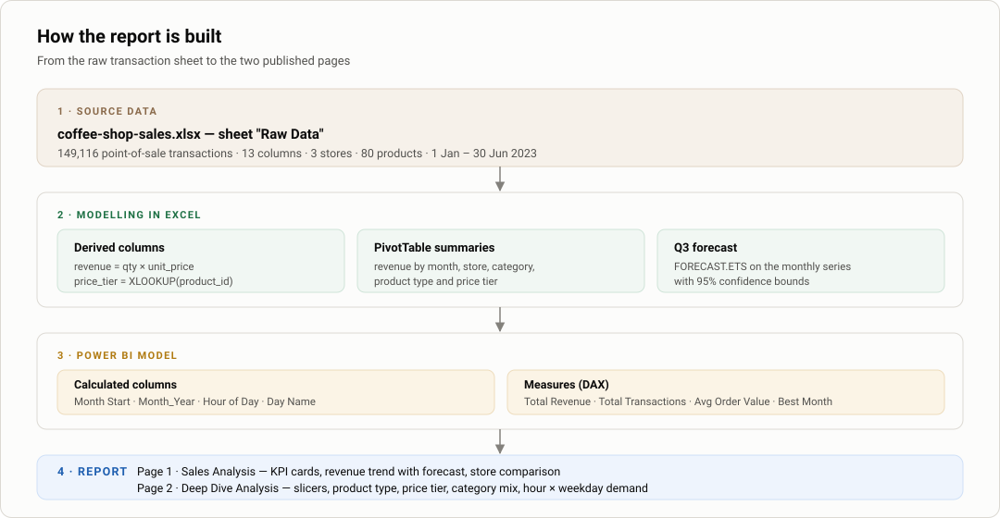
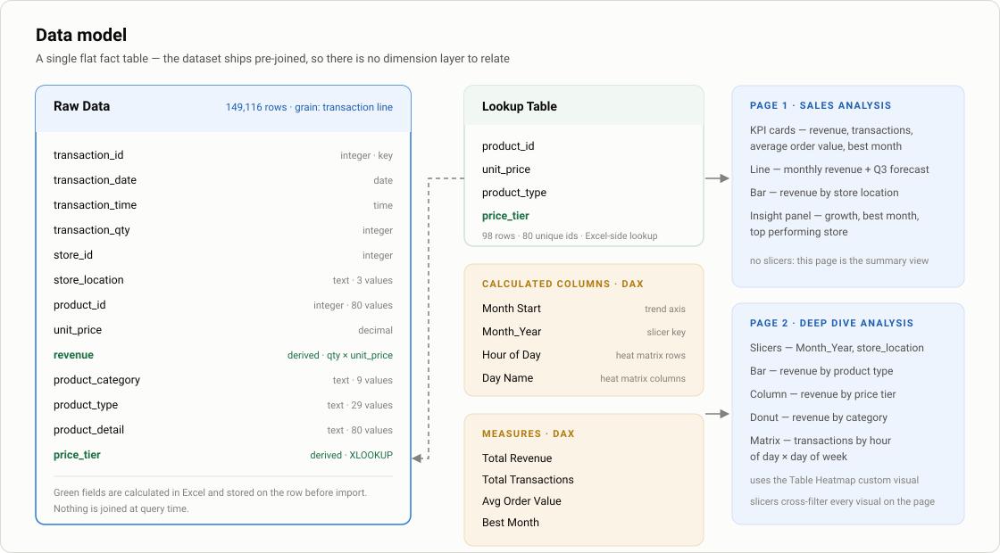

<p align="center">
  
</p>

<h1 align="center">Coffee Shop Sales Analytics</h1>

<p align="center">
  <em>Sales performance reporting for a three-store coffee retailer in New York City — 149,116 transactions, January to June 2023.</em>
</p>

<p align="center">
  
  
  
  
  
</p>

---

## Overview

A coffee retailer running three stores in New York City had six months of
point-of-sale data and no way to read it. The questions that matter to an
operator are specific and operational:

- **When are we busy enough to need more staff on the floor?**
- **Which products and which price points actually carry the revenue?**
- **Is one store underperforming, or are they all much the same?**
- **If the current trajectory holds, what does next quarter look like?**

149,116 transaction rows cannot answer any of that by being scrolled. This
project builds the layers that make them answerable: business rules applied in
Excel, a model and two report pages in Power BI, and a plain read of what the
data supports.

> **Scope.** The dataset has no customer identifier, no cost or margin, and no
> marketing, staffing or weather fields. So this reporting measures *what
> happened* and stops short of claiming *why*. The limits are listed in
> [What this data cannot answer](docs/insights.md#what-this-data-cannot-answer).

---

## The report

<!-- DASHBOARD PAGE EXPORTS
     Export the two pages from Power BI Desktop into assets/screenshots/
     (see assets/screenshots/README.md), then delete this comment wrapper
     and the closing arrow below so the images publish.

<p align="center">
  
  <br><sub><strong>Page 1 · Sales Analysis</strong></sub>
</p>

<p align="center">
  
  <br><sub><strong>Page 2 · Deep Dive Analysis</strong></sub>
</p>
-->

### Page 1 · Sales Analysis

The summary view. Deliberately carries **no slicers**, so the KPI cards always
describe the full period and cannot be misread out of context.

| Element | Shows |
| --- | --- |
| KPI cards | Total Revenue · Total Transactions · Avg Order Value · Best Month |
| Line chart | Monthly revenue trend with the Q3 forecast overlaid |
| Bar chart | Revenue by store location |
| Insights panel | Revenue growth, best month, top-performing store |

### Page 2 · Deep Dive Analysis

The exploratory view. Month and store slicers cross-filter every visual.

| Element | Shows |
| --- | --- |
| Slicers | Month, Store Location |
| Bar chart | Revenue by product type — 29 types ranked |
| Column chart | Revenue by price tier — Budget / Mid / Premium |
| Donut chart | Revenue by product category — 9 categories |
| Heat matrix | Transactions by hour of day × day of week |

---

## Key findings

| Finding | Number | Why it matters |
| --- | --- | --- |
| Revenue more than doubled over the half-year | **+103.8%** Jan → Jun | Growth is entirely volume — transactions rose +104.2% while average order value stayed flat. |
| The morning rush is the business | **45.2%** of transactions land 07:00–10:59 | A flat rota across a 15-hour trading day is mismatched to this demand curve. |
| Day of week barely matters | busiest day only **5.8%** above quietest | Schedule against the clock, not the calendar. |
| Two categories carry revenue | Coffee + Tea = **66.7%** | Concentration risk, and the obvious place to protect availability. |
| Premium punches above its volume | **2.6%** of transactions, **9.6%** of revenue | A 3.7× revenue-to-volume ratio — the clearest mix lever in the data. |
| The three stores are interchangeable | **2.8%** spread best to worst | There is no underperforming site to fix here. |

**Headline numbers**

| | | | |
| --- | --- | --- | --- |
| **$698,812.33** <br><sub>revenue, H1 2023</sub> | **149,116** <br><sub>transactions</sub> | **$4.69** <br><sub>avg order value</sub> | **214,470** <br><sub>units sold</sub> |

Full discussion, month-by-month tables and caveats: **[docs/insights.md](docs/insights.md)**.

---

## How it is built

<p align="center">
  
</p>

Two business rules are applied in Excel and stored on the row, so the enrichment
is visible to anyone who opens the workbook rather than buried in a measure:

```excel
revenue      =D2*H2
price_tier   =XLOOKUP(G2,'Lookup Table'!$A:$A,'Lookup Table'!$D:$D,"Unkown")
```

`price_tier` resolves through a reference sheet that bands unit price:

```excel
=IF(B5<=3,"Budget",IF(B5<=8,"Mid","Premium"))
```

The Q3 projection uses Excel's exponential smoothing on the six-month revenue
series, with explicit 95% bounds:

```excel
=FORECAST.ETS(A11,$B$5:$B$10,$A$5:$A$10,1,1)
=FORECAST.ETS.CONFINT(A11,$B$5:$B$10,$A$5:$A$10,0.95,1,1)
```

Step-by-step: **[docs/methodology.md](docs/methodology.md)**.

---

## Data model

<p align="center">
  
</p>

A **single flat fact table**. The extract arrives pre-joined — store name and the
full product hierarchy are already on every transaction row — so there is no
dimension layer to relate.

| | |
| --- | --- |
| Grain | one row per product line on a transaction |
| Rows | 149,116 |
| Columns | 13, of which 2 are derived in Excel (`revenue`, `price_tier`) |
| Calculated columns | `Month Start`, `Month_Year`, `Hour of Day`, `Day Name` |
| Measures | `Total Revenue`, `Total Transactions`, `Avg Order Value`, `Best Month` |

The trade-off is worth naming: without a marked date table, DAX time
intelligence such as `SAMEPERIODLASTYEAR` and `DATESYTD` is unavailable. With
one half-year of data and no year-over-year comparison to make, that cost has
not yet been paid — adding a date dimension is the first item in
[Future enhancements](#future-enhancements).

Column definitions: **[data/data-dictionary.md](data/data-dictionary.md)** ·
Model detail: **[docs/data-model.md](docs/data-model.md)**.

---

## Opening the files

**The report** — `powerbi/coffee-shop-sales-dashboard.pbix`

1. Install [Power BI Desktop](https://powerbi.microsoft.com/desktop/) (free, Windows).
2. Open the file.
3. Page 2 uses the **Table Heatmap** custom visual, bundled in the report — accept
   the prompt to load it when Power BI asks.

On macOS or Linux, upload the `.pbix` to [app.powerbi.com](https://app.powerbi.com)
with a Microsoft work or school account and view it in the browser.

**The data** — `data/coffee-shop-sales.xlsx`

Opens in Excel or any compatible spreadsheet application. All formulas,
PivotTables and the forecast chart are live.

| Sheet | Contents |
| --- | --- |
| `Raw Data` | The fact table — 149,116 rows, columns A–M |
| `Lookup Table` | Price-band reference driving `price_tier` |
| `Revenue Overview` | Revenue by month; revenue and avg order value by store |
| `Product Analysis` | Category revenue mix; revenue and transactions by product type |
| `Price Tier Analysis` | Transactions and revenue by tier |
| `Forecast` | Monthly series, `FORECAST.ETS` projection and chart |

---

## Project structure

```
coffee-shop-sales-analytics/
│
├── README.md
├── LICENSE
│
├── powerbi/
│   └── coffee-shop-sales-dashboard.pbix     2 pages, 4 measures, 4 calculated columns
│
├── data/
│   ├── coffee-shop-sales.xlsx               6 sheets, 149,116 rows, 5 PivotTables
│   └── data-dictionary.md                   every column defined, with provenance
│
├── docs/
│   ├── methodology.md                       how the numbers were produced, in order
│   ├── data-model.md                        table, columns, measures, trade-offs
│   └── insights.md                          the findings, with tables and caveats
│
└── assets/
    ├── banner.svg
    ├── architecture.svg
    ├── data-model.svg
    └── screenshots/                         report page exports
```

---

## Data quality

The source is clean: **zero** nulls across 149,116 rows and 13 columns, no
missing trading days across the 181-day period, no duplicate transaction ids,
and every transacted product resolves to a price tier.

One ambiguity is worth recording. The price-band reference sheet holds 98 rows
covering 80 products — several products are listed at more than one price point.
`XLOOKUP` returns the first match, so for 15 product ids the row order decides
which price is consulted. For 14 of them both rows land in the same tier, so
nothing changes. For **one** (`product_id` 72, listed at $2.65, $3.25 and $4.06)
the rows disagree, making its tier order-dependent.

It affects two visuals and no KPI card. The clean fix is to band each transaction
on its own `unit_price` rather than on a looked-up one —
`=IF(H2<=3,"Budget",IF(H2<=8,"Mid","Premium"))` — which removes the lookup from
the path entirely. That is listed below rather than patched silently.

---

## Future enhancements

| | Enhancement | Why |
| --- | --- | --- |
| 1 | **Marked date dimension** | Unlocks DAX time intelligence — `DATESYTD`, `SAMEPERIODLASTYEAR`, month-over-month as a measure rather than a reading off the trend. |
| 2 | **Band price tier on the row's own `unit_price`** | Removes the lookup from the critical path and resolves the `product_id` 72 ambiguity outright. |
| 3 | **Power Query ingestion** | Replace in-sheet formulas with a refreshable M pipeline, so a new month is a refresh rather than an edit. |
| 4 | **A fitted forecast model** | Six monthly points cannot separate trend from seasonality; daily or weekly grain with a hold-out would give a defensible projection. |
| 5 | **Basket analysis** | `transaction_id` groups lines, so co-purchase pairs are derivable even without a customer identifier. |
| 6 | **Margin, if cost data can be obtained** | Would turn the Premium-tier finding from a revenue argument into a profit one. |
| 7 | **Publish to the Power BI Service** | Scheduled refresh, row-level security per store, and mobile layouts. |

---

## Data and licensing

The transaction data describes a retailer trading as *Maven Roasters* and
contains no customer, staff or payment details. The [MIT licence](LICENSE)
covers the documentation in this repository; the dataset remains under its own
original terms.

---

## Author

**YOUR NAME**

[](https://linkedin.com/in/YOUR_LINKEDIN)
[](https://github.com/YOUR_GITHUB_USERNAME)
[](mailto:YOUR_EMAIL)
