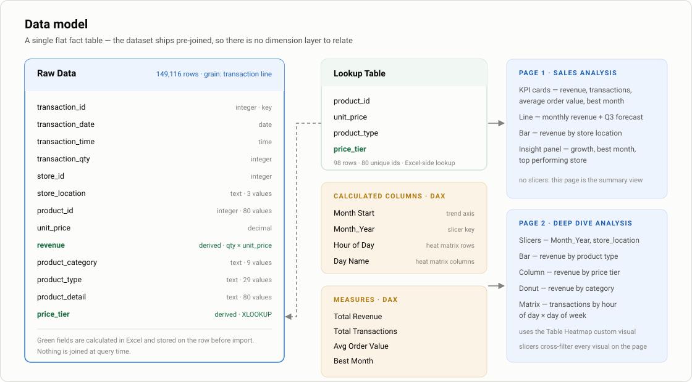

# Data model

<p align="center">
  
</p>

## Shape: a single flat table

The report runs on one table. The source extract arrives pre-joined — store name
and the full product hierarchy are already denormalised onto every transaction
row — so there is no dimension layer to relate.

This is a deliberate choice for a dataset of this size and shape, not an
oversight:

| | Flat table (chosen) | Star schema |
| --- | --- | --- |
| Rows scanned | 149,116 — trivial for the VertiPaq engine | same |
| Model complexity | one object | four or five, plus relationships |
| Slicer behaviour | works directly off the fact table | needs dimension tables |
| Time intelligence | limited: no marked date table | full DAX time intelligence available |
| Repeating text | `product_detail` and `store_location` repeat on every row | stored once |

The cost is real and worth naming: without a marked date table, DAX time
intelligence functions such as `SAMEPERIODLASTYEAR` and `DATESYTD` are not
available, and month-over-month growth has to be read off the trend rather than
computed as a measure. With a single half-year of data and no year-over-year
comparison to make, that cost has not yet been paid. Introducing a proper date
dimension is the first item in [Future enhancements](../README.md#future-enhancements).

## Fact table — `Raw Data`

149,116 rows. Grain: one row per product line on a transaction. Full column
definitions are in [`../data/data-dictionary.md`](../data/data-dictionary.md).

Two columns are derived in Excel and stored on the row:

```excel
revenue      =D2*H2
price_tier   =XLOOKUP(G2,'Lookup Table'!$A:$A,'Lookup Table'!$D:$D,"Unkown")
```

## Reference table — `Lookup Table`

98 rows covering 80 products, used only to resolve `price_tier` inside Excel.
It is **not** loaded into the Power BI model and there is no relationship to
maintain — the lookup has already been applied by the time the data is imported.

```excel
Price Tier   =IF(B5<=3,"Budget",IF(B5<=8,"Mid","Premium"))
```

| Tier | Unit price | Transactions | Revenue | Share of revenue |
| --- | --- | ---: | ---: | ---: |
| Budget | ≤ $3.00 | 84,218 | $320,340.75 | 45.8% |
| Mid | $3.01 – $8.00 | 61,040 | $311,592.89 | 44.6% |
| Premium | > $8.00 | 3,858 | $66,878.69 | 9.6% |

## Calculated columns

Added in Power BI to give the fact table the time grain the visuals need.

| Column | Purpose |
| --- | --- |
| `Month Start` | Continuous month axis for the revenue trend line. |
| `Month_Year` | Readable month key behind the Deep Dive slicer. |
| `Hour of Day` | Row axis of the demand heat matrix. |
| `Day Name` | Column axis of the demand heat matrix. |

## Measures

| Measure | What it returns | Surfaced on |
| --- | --- | --- |
| `Total Revenue` | Sum of the `revenue` column over the current filter context. | KPI card, trend line, every breakdown chart. |
| `Total Transactions` | Count of transaction lines in the current filter context. | KPI card, heat matrix cells. |
| `Avg Order Value` | Revenue per transaction line. | KPI card, store comparison. |
| `Best Month` | The month carrying the highest revenue. | KPI card. |

Full-period values, reconciled against the workbook PivotTables:

| Measure | Value |
| --- | --- |
| `Total Revenue` | $698,812.33 |
| `Total Transactions` | 149,116 |
| `Avg Order Value` | $4.6864 |
| `Best Month` | June 2023 |

> The DAX expressions themselves live inside `powerbi/coffee-shop-sales-dashboard.pbix`.
> Power BI stores its model in a compressed container that is not readable as
> text, so this page documents each object's definition and behaviour rather
> than pasting source that could fall out of step with the file. Open the report
> in Power BI Desktop to read the expressions.
